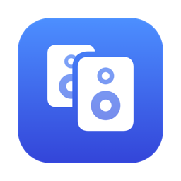

<p align="center"></p>
<h1 align="center">Ensemble</h1>

<p align="center">
  Play your Mac's sound on all your speakers at once, and on your other Mac, in sync.<br>
  Built-in speakers, Bluetooth, displays: one sound, one volume, video in sync. It lives in the menu bar.<br>
  Free and open source. No account, no tracking.
</p>

<p align="center">
  <a href="https://github.com/LaCreArthur/duet/releases/latest/download/Ensemble.dmg"></a>
</p>

<p align="center">
  
  
  
  <a href="LICENSE"></a>
</p>

- Every app's sound, on every speaker you tick, heard together.
- Video stays in sync: players hold the picture back by the same delay as the sound.
- Add your other Mac: it plays along, and its menu and media keys play, pause and skip.
- One volume for everything: the volume keys on either Mac set it.
- Tune the sync with the microphone, for speakers that report their delay wrong.

## Requirements

macOS 26 or later (Apple silicon or Intel). For a second Mac: the same, on the same local network.

## Install

1. Download [Ensemble.dmg](../../releases/latest/download/Ensemble.dmg) (all versions: [Releases](../../releases))
   and drag Ensemble to Applications.
2. Open Ensemble. Its setup guide takes you through three steps, and says why before macOS asks anything:
   - install Ensemble's sound device, which keeps video in sync (macOS asks for your password);
   - turn on **Share this Mac's sound**, tick your speakers, and allow Ensemble to record the sound;
   - optional: open Ensemble on your other Mac, allow it on your local network, and pair the two Macs
     (both show a code: click **Pair** on each if the codes match).

Ensemble lives in the menu bar and opens at login; the guide and the login setting are in its menu.

## Privacy

The sound and the controls go only to the Mac you paired, if any, on your local network, encrypted with a key
the two Macs made when you paired them (ChaCha20-Poly1305). The key stays in your login keychain. The
microphone is used only while you tune the sync. Once a day Ensemble asks GitHub for its latest version;
it sends nothing else anywhere.

## How it compares

| | Ensemble | macOS Multi-Output | [Tutti](https://github.com/BarryBarrywu/tutti) | [FineTune](https://github.com/ronitsingh10/FineTune) | [Airfoil](https://rogueamoeba.com/airfoil/mac/) |
|---|---|---|---|---|---|
| Price | Free | Free | Free, Pro $7.99 | Free | Paid |
| Open source | ✅ | ❌ | ❌ | ✅ | ❌ |
| Several speakers on one Mac | ✅ | ✅ | ✅ | ✅ | ✅ |
| Your other Mac plays along | ✅ | ❌ | ❌ | ❌ | ✅ |
| Video in sync, in any player | ✅ | ? | ? | ? | ? |
| Volume keys move every speaker | ✅ | ❌ | ✅ | ❌ | ? |
| AirPlay, Sonos, phones | ❌ | ? | ❌ | ❌ | ✅ |
| Per-app volume and EQ | ❌ | ❌ | ✅ | ✅ | ? |

? = not measured yet. Pick something else if you need AirPlay or Sonos speakers (Airfoil), or volume
and EQ per app (FineTune, Tutti).

## Uninstall

Quit Ensemble and delete it from Applications. To remove its sound device:

```sh
sudo rm -rf /Library/Audio/Plug-Ins/HAL/EnsembleDevice.driver && sudo killall coreaudiod
```

The pairing is the "Duet pairing" item in Keychain Access.

## How it works

The sharing Mac captures every app's sound with a Core Audio process tap and plays it on its speakers a
fixed delay later, about a quarter of a second. The same frames go to the other Mac over UDP, with clocks
kept in step, so both Macs play each frame at the same moment. Ensemble's sound device (`Driver/`, an
Audio Server plug-in) becomes the Mac's sound output while it shares: it reports that delay as its
latency, so video players hold the picture back to match.

## Build

Needs Xcode 26.

```sh
DUET_IDENTITY="Apple Development: Your Name (TEAMID)" scripts/build-app.sh   # builds and installs in /Applications
scripts/release.sh   # Developer ID signed, notarized DMG in build/
```

`duet-lab` (`swift run duet-lab`) holds the measurement tools used to tune the sync.

## License

MIT
